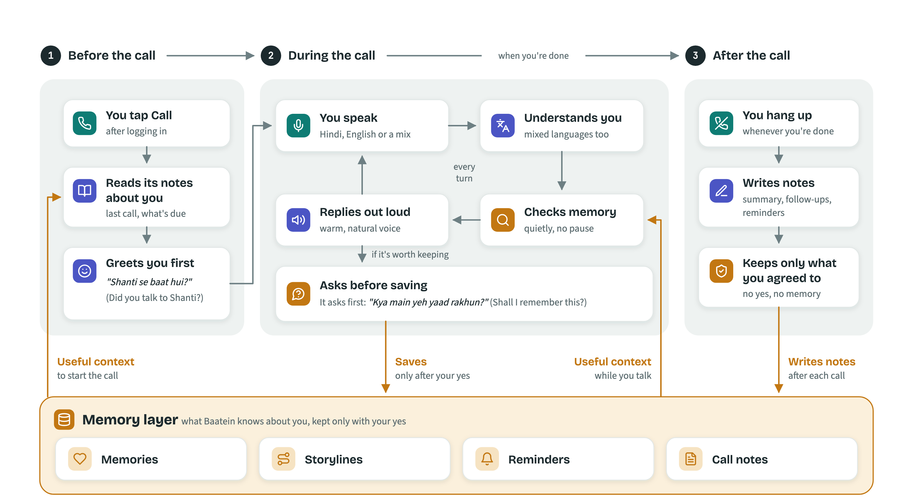

# Baatein

**A voice friend that remembers you.** Talk to it in the mix of Hindi and English you actually speak. It remembers what you agree it can keep, and picks up where you left off next time: *"Shanti se baat hui?"* ("Did you talk to Shanti?")

Live at **[baatein-ai.experiship.com](https://baatein-ai.experiship.com)** (invite-only test accounts).



## Why

Talking to an AI today is like meeting a stranger every time.

- **It forgets.** It doesn't know your daughter's name, the friend you meant to call, or the father you lost last year.
- **It wants one language.** Pure English or pure Hindi, while India speaks a mix.
- **It keeps things without asking.** What it does remember, you can't see, correct or delete.

The people who most need someone to talk to, like an older parent living alone, are the ones these tools serve worst.

## What Baatein does

**Speaks your mix.** Hindi and English in the same sentence, the way people talk: *"Aaj ghutne mein thoda dard tha"* ("My knee hurt a bit today"). It works in English, Hindi and Hinglish.

**Remembers, with your permission.** Before keeping anything, it asks: *"Kya main yeh yaad rakhun?"* ("Shall I remember this?") Nothing is saved without a yes.

**Follows up.** It keeps track of the stories you're living through and checks in later, at most every few days, so it never nags.

**Brings up dates at the right time.** Birthdays, doctor visits, anything with a date. When the day comes, it mentions it in the greeting: *"Aditya ka birthday aaj hai na!"* ("It's Aditya's birthday today, right?")

**Adapts to you.** Older people get a slower, patient, respectful style ("Kamala ji"), Hindi first, with fewer questions. You can also ask: *"Dheere bolo"* ("Speak slower"), *"Itne sawaal mat poochho"* ("Don't ask so many questions").

**Never makes you wait.** It looks up memories while you talk. If it needs a second, it says "Hmm…", like a person would.

## You stay in control

Everything is done by just saying it in the call:

| You say | Baatein |
|---|---|
| *"Mira nahi, Myra hai"* ("Not Mira, it's Myra") | corrects the memory |
| *"Yeh bhool jao"* ("Forget this") | forgets it |
| *"Forget me"* | erases everything about you |
| *"Aaj kuch save mat karna"* ("Don't save anything today") | saves nothing for this call |
| *"Job ki baat mat karna"* ("Don't talk about my job") | avoids the topic, for this call, until you bring it up, or until a date |

Health, grief and personal matters are treated as sensitive and brought up gently, or not at all. Codes and long numbers, like an OTP, are removed before anything is stored.

## How it works

1. **Before the call**, Baatein reads its notes about you: your name, the last call, plans you mentioned, anything due soon. It greets you first.
2. **During the call**, it listens, understands mixed Hindi-English, checks its memory and replies in a warm, natural voice. When it hears something worth keeping, it asks first.
3. **After the call**, it writes a short summary and follow-ups. It keeps only what you agreed to.
4. **The memory layer** holds four kinds of things: memories (facts and moments), storylines (plans in progress), reminders (dates) and call notes. The next call starts from them.

## How we know it works

| What we tested | Result |
|---|---|
| **Real conversations.** 39 scenarios from a 45-situation library: grief, corrections, "don't save this", topics to avoid, an older person repeating a story, multi-day call sequences | All pass, twice in a row, against the real model |
| **Finding the right memory.** 31 questions, each asked in English, Hindi and Hinglish, plus small talk that should find nothing ([benchmark](docs/RETRIEVAL_BENCHMARK.md)) | Right memory first: 29/31 English, 28/31 Hindi, 24/31 Hinglish |
| **Voices.** 9 voices on the same streamed reply, listening for tone changes mid-sentence | Picked the steadiest one |
| **Code.** Unit, contract, integration and API tests, run in CI on every change | 100% branch coverage, strict type checks |

## Built with

| Part | What we used |
|---|---|
| Live call | [LiveKit Agents](https://github.com/livekit/agents) and LiveKit Cloud |
| Hearing | Sarvam `saaras:v4`, code-mixed speech to text |
| Thinking | Claude Haiku 5.5, for the conversation and the after-call notes |
| Speaking | Sarvam `bulbul:v3`, voice Ritu |
| Memory | SQLite with `sqlite-vec` (meaning) and FTS5 (exact words), fused; Pinecone `llama-text-embed-v2` embeddings |
| App | Python 3.12, FastAPI, a plain web page; hosted on Railway |

The code uses ports and adapters: the memory, storage and voice providers sit behind small interfaces, so a provider or database can be swapped without touching the conversation logic.

```
src/baatein/
  agent/     the voice agent: call entrypoint, conversation, memory tools
  memory/    memory layer: context and greeting, search, consent, reminders, after-call notes
  voice/     languages, personas, speech and voice providers
  api/       web server and the web page
  auth/      accounts and sign-in
  storage/   SQLite database, migrations, vector and keyword search
  domain/    core models: users, calls, memories, storylines, reminders
  ports/     the interfaces everything plugs into
tests/       unit, contract, integration, API and real-conversation tests
bench/       memory search benchmark
docs/        memory design, decision log, retrieval benchmark
```

More detail: [memory design](docs/MEMORY_DESIGN.md), [decision log](docs/DECISIONS.md), [retrieval benchmark](docs/RETRIEVAL_BENCHMARK.md).

## What's next

**Version 2**
- A mobile app for setting reminders: birthdays, doctor visits, medicines and anything else that matters, with alerts at the right time, not only during a call

**Then**
- **Personas people love.** People expect to be spoken to in a certain way. A 70-year-old could choose to have Baatein talk in the style of their grandchild.
- **More languages.** Beyond English, Hindi and Hinglish, so many more people can use it, starting with Kannada and Odia (already in the code).
- **Doing things for you, with permission.** For example, ordering a cake from a favourite restaurant for a grandchild's birthday, if Baatein is given access to Zomato or Swiggy.
- **Care for older users.** Medicine reminders that ask whether you took it, and a daily check-in call from Baatein at a time you choose.
